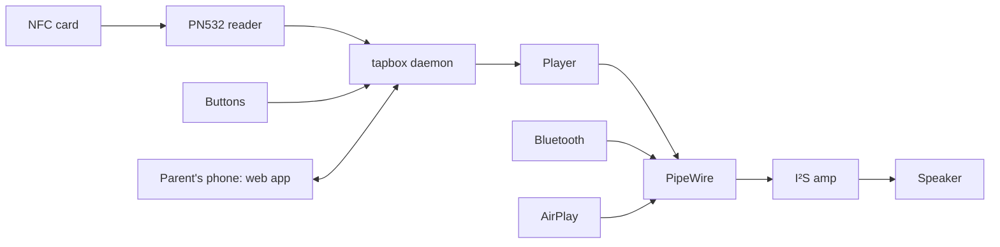

# tapbox

**An open-source, screen-free audio player for kids that you build yourself.**
Tap a card, hear a story. Like HiRO, Toniebox or Yoto, but open: open hardware, open software and an open card format, so a card made for one tapbox plays on every tapbox.

[](https://github.com/MathiasNI/tapbox/actions/workflows/ci.yml)

> **Status: early development.** The card format, its codec and safe card writing are done and tested. The player daemon, reader driver and web app are next. See the [roadmap](#roadmap).

## What it does

- **NFC cards** play local files, web audio, podcasts or Spotify. Content is found by hash, so cards work offline and on other people's boxes.
- **Bluetooth speaker** mode: pair a phone and use the box as a normal speaker.
- **AirPlay speaker** mode: shows up in the AirPlay picker on iPhone and Mac.
- **No screen.** Three big buttons, one status light, and a web app on the parent's phone for setup.
- **Made for kids:** volume limit, battery behind screws, pause when the card is lifted.

## How it works



A card doesn't store audio (an NTAG215 holds 504 bytes). It stores a small pointer:

```json
{"v":1,"t":"Bedtime songs","s":["ni:///sha-256;47DEQpj8…","https://example.org/songs.m3u"]}
```

The box tries each source in order: its own library by content hash first, then the URL, then plugins such as Spotify. The full format is in [`docs/card-spec.md`](docs/card-spec.md).

## Build your own

| Step | Guide |
|---|---|
| 1. Buy the parts (Pi Zero 2 W, PN532 reader, amp, speaker, buttons) | [`docs/hardware.md`](docs/hardware.md) |
| 2. Print the case | [`docs/enclosure.md`](docs/enclosure.md), model in [`hardware/enclosure/`](hardware/enclosure/) |
| 3. Wire it up | [`docs/hardware.md#wiring-bcm-gpio--physical-pin`](docs/hardware.md#wiring-bcm-gpio--physical-pin) |
| 4. Install the software | Coming soon (Raspberry Pi OS image + installer) |
| 5. Set up Wi-Fi and make cards | [`docs/setup-ux.md`](docs/setup-ux.md) |

Want a different case, reader or speaker? Go ahead. Anything that speaks the card format is a tapbox.

### Make a card today

The `tapbox` command-line tool already encodes and decodes cards:

```sh
cargo install --path crates/tapbox-cli

tapbox hash story.mp3                       # -> ni:///sha-256;…
tapbox encode --title "Story" \
  --source "$(tapbox hash story.mp3)" \
  --source https://example.org/story.mp3    # -> hex bytes for the tag
tapbox decode 039bd21b…                     # -> the card as JSON
tapbox encode --command vol-max:60          # an admin card
```

## Repository layout

```
tapbox/
├── crates/
│   ├── tapbox-card/        Open card format: NDEF, TLV, hashes, validation (no_std)
│   ├── tapbox-hw/          Reading and safely writing NTAG cards; drivers plug in here (no_std)
│   └── tapbox-cli/         `tapbox` CLI: hash, encode and decode cards
├── card-spec/
│   ├── vectors/            Shared test vectors every implementation should pass
│   └── tools/              Independent generator for the vectors
├── docs/
│   ├── card-spec.md        The card format (draft v0.1)
│   ├── architecture.md     How the software fits together
│   ├── hardware.md         Parts list, wiring, compatibility checks
│   ├── enclosure.md        Case dimensions, printing, assembly
│   ├── setup-ux.md         Setup without a screen: Wi-Fi, web app, LED, gestures
│   └── research.md         Background research, with sources
├── hardware/
│   └── enclosure/          Parametric OpenSCAD case (shell + back lid)
├── .github/workflows/      CI: fmt, clippy, tests, no_std and Raspberry Pi builds
├── CONTRIBUTING.md
└── CLAUDE.md               Conventions for AI-assisted development
```

## Developing

Rust, with the toolchain pinned in `rust-toolchain.toml`. No hardware needed: `tapbox_hw::MemoryTag` simulates an NTAG215.

```sh
cargo test --workspace
cargo clippy --workspace --all-targets -- -D warnings
cargo fmt --all
```

`tapbox-card` and `tapbox-hw` are `no_std`, so the same code can run in the browser (WebAssembly) and on microcontrollers. See [`docs/architecture.md`](docs/architecture.md) and [`CONTRIBUTING.md`](CONTRIBUTING.md).

## Roadmap

- [x] Card format draft v0.1 with test vectors
- [x] Card codec (`tapbox-card`)
- [x] Safe card reading and writing with verification (`tapbox-hw`)
- [x] Developer CLI
- [ ] PN532 driver over I²C
- [ ] Daemon: resolve sources, play, buttons, status LED, source priority
- [ ] Bluetooth and AirPlay speaker modes
- [ ] Web app: library, link and write cards, settings
- [ ] Wi-Fi onboarding, admin cards
- [ ] Spotify plugin (go-librespot)
- [ ] Raspberry Pi OS image, read-only root, updates
- [ ] Enclosure v1 tested and printed

## Safety

tapbox is meant for children. Use quality parts from the [parts list](docs/hardware.md), keep the battery behind screws, and set a volume limit. A home-built box is not safety-certified like a shop-bought toy; you build and use it at your own responsibility.

## Prior art

Thanks to the projects that showed the way: [Phoniebox](https://github.com/MiczFlor/RPi-Jukebox-RFID), [ESPuino](https://github.com/biologist79/ESPuino), [TonUINO](https://www.voss.earth/tonuino/), [shairport-sync](https://github.com/mikebrady/shairport-sync) and [go-librespot](https://github.com/devgianlu/go-librespot).

## License

Not chosen yet. Common choices are MIT or Apache-2.0 for code and the card spec, and CERN-OHL-P or CC BY 4.0 for hardware files.
