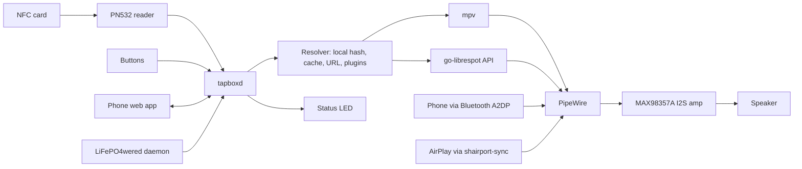

# Architecture

## Overview

## Components

The daemon is Rust (`tapboxd`), split into small crates. Research and crate choices: [`software-rust.md`](software-rust.md).

| Component | Responsibility | Tech |
|---|---|---|
| Card codec (`tapbox-card`) | Decode NDEF, validate against `card-spec.md`, produce a typed `Card` | Pure Rust, no I/O, unit-tested, checked against test vectors |
| Core (`tapbox-core`) | State machine: events in, commands out. Arbitration, resume, card-lifted behaviour, gestures | Pure Rust, no I/O, no clock |
| Reader | Wait for PN532 card present/removed (IRQ, polling fallback), emit UID and NDEF bytes | `pn532` + `linux-embedded-hal` (I²C) |
| Buttons, LED | Debounced button events; RGB status light | `gpiocdev` (kernel debounce); sysfs PWM via `pwm-gpio` overlay |
| Battery | Battery level, low-battery and shutdown events | LiFePO4wered/Pi+ daemon (`lifepo4wered-cli`) |
| Resolver | Turn sources into something playable: local library by hash → cache → download (verify hash) → plugin | `reqwest` (rustls), `sha2` |
| Player | Play/pause/volume, resume position per card (in memory, per session) | mpv as supervised child, typed JSON-IPC client |
| Arbiter | Decide which source owns the speaker (rules in the core) | BlueZ over D-Bus, shairport-sync hooks |
| Bluetooth | Pairing window, auto-accept agent, transport state | BlueZ over D-Bus (`zbus`) |
| AirPlay | Receiver | shairport-sync + NQPTP |
| Spotify plugin | Play `spotify:` URIs | go-librespot, local HTTP API |
| Web app | Library, uploads, link/write cards, settings | `axum`, served by the daemon on `http://<name>.local` |
| Onboarding | Wi-Fi setup when no network is known | comitup |
| Control socket | `tapbox-ctl` for hooks and debugging | Unix socket, line protocol |

## Source priority (arbiter)

Rule: **last source to start wins.**

| Event | Action |
|---|---|
| Card tapped | Pause/stop Bluetooth stream (AVRCP Pause over BlueZ D-Bus) and take the output; AirPlay can't be paused remotely, so duck/mute its stream locally |
| Bluetooth starts streaming | Pause card playback, remember position |
| AirPlay session begins (hook) | Pause card playback, remember position |
| Card removed | Configurable: pause (default, like Toniebox) or keep playing |
| Same card tapped again | Resume from saved position |
| Different card tapped | That card takes over |
| Card can't be played | Red flash; the reason goes into the problem log (shown in the web app) |

## Audio stack

- PipeWire + WirePlumber as the single mixer, running as user services of the `tapbox` user with lingering enabled.
- WirePlumber Bluetooth role: `a2dp_sink`.
- shairport-sync output to PipeWire (via its PulseAudio backend), with session hooks calling `tapbox-ctl`.
- mpv outputs to PipeWire.
- Global maximum volume enforced in the daemon (hearing protection), applied to every source.

## Boot and supervision

- `tapboxd` is a systemd **user unit** of `tapbox`, ordered after PipeWire/WirePlumber.
- `Type=notify`: `READY=1` only after reader, mpv and web server are up. `WatchdogSec=10s`, pinged from the main event loop; `Restart=always`.
- Hardware watchdog for kernel hangs: `RuntimeWatchdogSec=15s` in `/etc/systemd/system.conf`.
- Shipped as a `.deb` (cargo-deb) with units and default config.

## Robustness

- Read-only root with overlayfs (**required**: the master switch cuts power without warning), data on a separate writable partition (library, cache, settings).
- tapboxd writes almost nothing: only the parents' max volume, atomically (temp → fsync → rename), when it changes. Wi-Fi and Bluetooth pairings (NetworkManager, BlueZ) live on the writable data partition.
- Power on/off is a latching master switch in the battery line. OFF is a hard cut; ON boots via the LiFePO4wered/Pi+ `AUTO_BOOT_VBAT` setting. Switching off is a fresh start by design: resume positions and volume live in memory only; the testbench's `power cut` checks this. On low battery the board still shuts the Pi down cleanly (GPIO14 shutdown detect); tapboxd sees that as SIGTERM and stops playing.
- Card data is untrusted input: size limits, allowed schemes only, no local paths from cards, hashes verified after download. No panics on card data (`unwrap`/`expect`/`panic` denied outside tests).

## Testbench

Before any hardware exists, `tapboxd sim` and `tapboxd test` run the same app against simulated hardware; see [`testbench.md`](testbench.md). The pieces that are simulated today (reader, buttons, LED, battery, Bluetooth/AirPlay, system actions) are replaced one at a time by real drivers.

## Language and quality bar

- Rust, pinned toolchain (`rust-toolchain.toml`), `Cargo.lock` committed, `--locked` builds. Pure-Rust dependencies only, so a static `aarch64-unknown-linux-musl` binary builds without a sysroot.
- `#![forbid(unsafe_code)]`, clippy pedantic, `cargo deny` in CI.
- Hardware behind traits with fakes, so the daemon runs and tests on a laptop.
- Card codec gets test vectors in `card-spec/` so other implementations (ESP32, phone apps) can verify against them.
