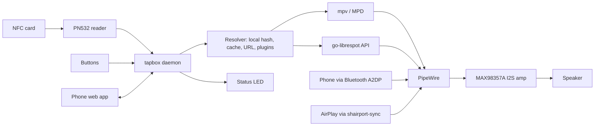

# Architecture

## Overview

## Components

| Component | Responsibility | Tech |
|---|---|---|
| Reader driver | Poll the PN532, emit card present/removed with UID; implements `Type2Tag` | Rust, own PN532 driver over Linux `i2cdev` (planned) |
| Card codec | Decode/encode NDEF, validate against `card-spec.md` | `tapbox-card` (Rust, `no_std`) ✅ |
| Tag access | Read cards; write them safely with read-back verification | `tapbox-hw` (Rust, `no_std`) ✅ |
| Resolver | Turn sources into something playable: local library by hash → cache → download (verify hash) → plugin | Rust (planned) |
| Player | Play/pause/next/volume, resume position per card | mpv over JSON IPC, from Rust (planned) |
| Arbiter | Decide which source owns the speaker | Rust, `zbus` (BlueZ), shairport-sync hooks (planned) |
| Bluetooth | Pairing window, auto-accept agent, transport state | BlueZ over D-Bus |
| AirPlay | Receiver | shairport-sync + NQPTP |
| Spotify plugin | Play `spotify:` URIs | go-librespot, local HTTP API |
| Web app | Library, uploads, link/write cards, settings | TypeScript, served by the daemon (`axum`) on `http://<name>.local`; card codec via WebAssembly (planned) |
| Onboarding | Wi-Fi setup when no network is known | comitup |
| Control socket | `tapbox-ctl` for hooks and debugging | Unix socket, line protocol |

## Source priority (arbiter)

Rule: **last source to start wins.**

| Event | Action |
|---|---|
| Card tapped | Pause/stop Bluetooth stream (AVRCP Pause over BlueZ D-Bus) and take the output; AirPlay can't be paused remotely, so duck/mute its stream locally |
| Bluetooth starts streaming | Pause card playback, remember position |
| AirPlay session begins (hook) | Pause card playback, remember position |
| Card removed | Configurable: pause (default, like Toniebox) or keep playing |
| Same card tapped again | Resume from saved position |

## Audio stack

- PipeWire + WirePlumber as the single mixer, running as a user service with lingering enabled.
- WirePlumber Bluetooth role: `a2dp_sink`.
- shairport-sync output to PipeWire (via its PulseAudio backend), with session hooks calling `tapbox-ctl`.
- mpv outputs to PipeWire.
- Global maximum volume enforced in the daemon (hearing protection), applied to every source.

## Robustness

- Read-only root with overlayfs, data on a separate writable partition (library, cache, settings).
- PiSugar handles safe shutdown on low battery.
- Card data is untrusted input: size limits, allowed schemes only, no local paths from cards, hashes verified after download.

## Language and quality bar

- Rust workspace, pinned toolchain, `clippy::pedantic` with warnings as errors, `unsafe` forbidden, no `unwrap`/`panic` outside tests.
- Hardware sits behind traits (`Type2Tag`), so everything else runs and tests on a laptop with `MemoryTag`.
- `tapbox-card` and `tapbox-hw` are `no_std`, so the same code can run in the browser (WebAssembly) and on microcontrollers.
- The card codec is checked against test vectors from an independent Python implementation (`card-spec/vectors/`), which other implementations can use too.
- Raspberry Pi peripherals through standard Linux interfaces (`i2cdev`, `gpiocdev`); not `rppal`, which was archived in July 2025.
- Why Rust: one static binary on a read-only system, low memory on the Pi Zero's 512 MB, fast boot, and a codec shared with the web app and future ESP32 boxes.
